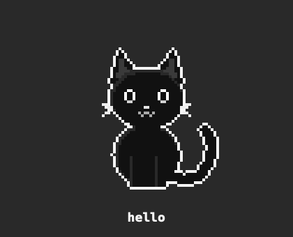
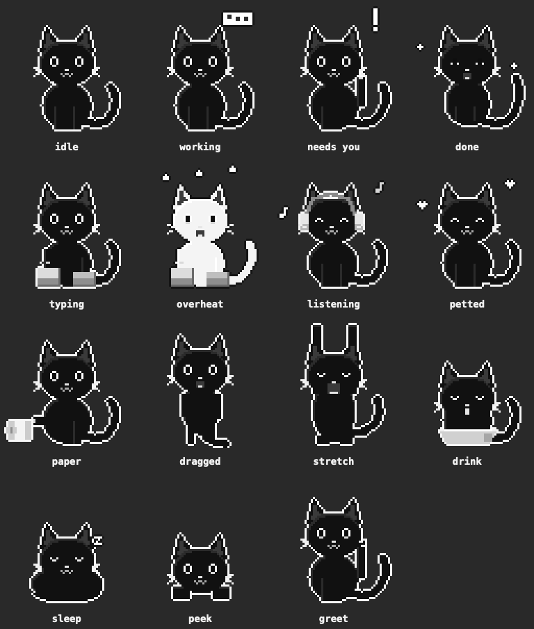

# Yoman Companion

A black-and-white pixel cat that keeps you company on macOS while you work, and keeps an eye on Claude Code for you.



Native Swift (AppKit + Core Animation), about 1 MB on disk, ~19 MB of memory and ~0.1–0.2% CPU when idle (a few percent while you type or move the mouse). On battery or in Low Power Mode it switches to a battery saver automatically.

## What it does



| | |
|---|---|
| **Claude Code** | Thinks along while Claude works, raises a paw and meows when Claude needs you (click the cat to jump to Claude), hops when a task is done. Works with the Claude desktop app and the CLI. |
| **Eyes follow** | Pupils track your cursor. |
| **Mochi drag** | Grab it anywhere: it stretches from where you hold it and swings when you shake it. Throw it and it lands. |
| **Hunting** | Move the cursor fast nearby and it crouches, wiggles and pounces straight up. |
| **Petting** | Wiggle the cursor over its head and it purrs. |
| **Typing** | Kneads keyboard keys while you type; turns white-hot with steam when you type too fast. |
| **Scrolling** | Unrolls a paper roll. |
| **Music** | Puts on headphones and bobs along to Apple Music or Spotify, and shows the song title. |
| **Reminders** | Grows big to stretch with you, drinks water with you, Pomodoro timer, a message at a time you pick, and a note pinned above its head. |
| **Peek mode** | Peeks from the screen edge while a full-screen video plays. |
| **Sleep** | Curls up after 10 minutes without input. |

Toggle it with **⌥⌘F** or from the cat icon in the menu bar (Settings, Pomodoro, reminders, pinned message).

## Build & install

```bash
scripts/build_app.sh            # builds dist/Yoman.app, signs it ad hoc, installs to ~/Applications
open ~/Applications/Yoman.app
```

Requires macOS 14+ on Apple Silicon and the Xcode Command Line Tools. It starts at login by default (menu → Launch at Login).
